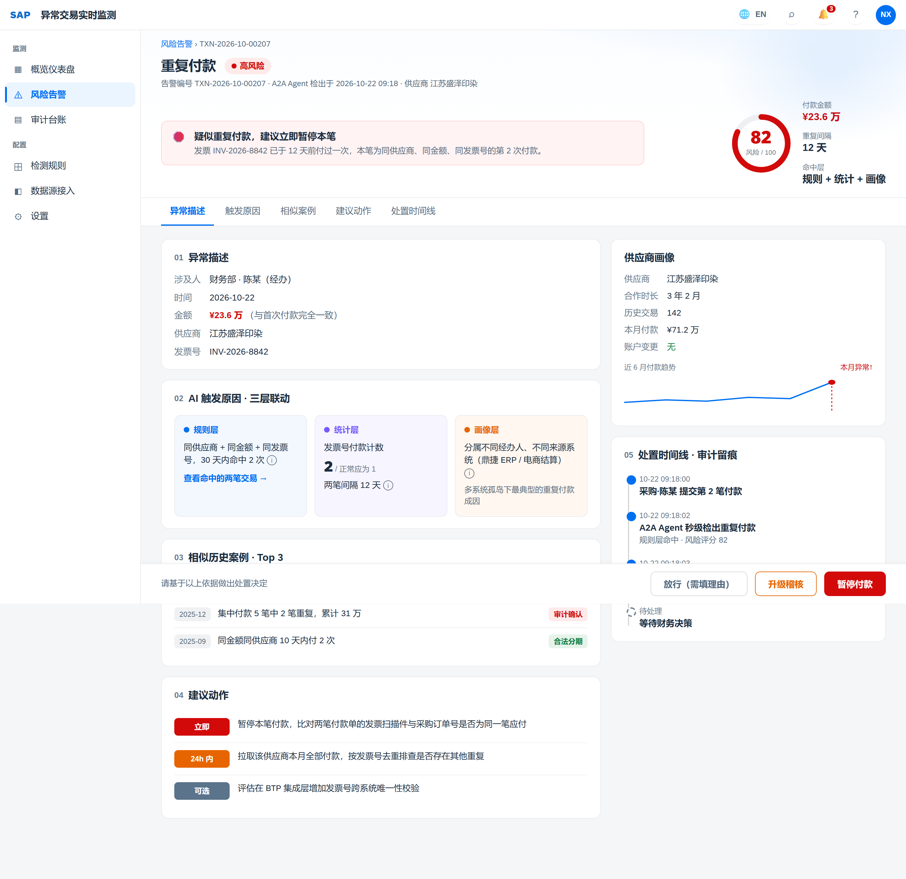
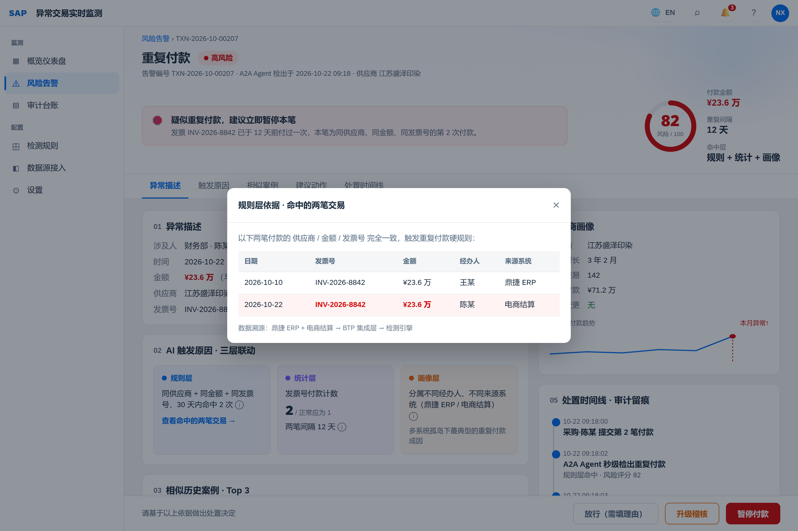
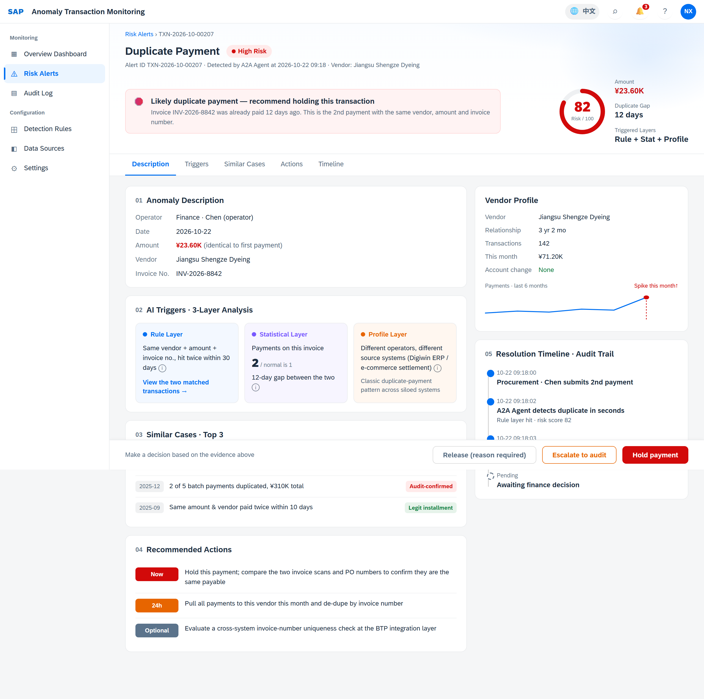
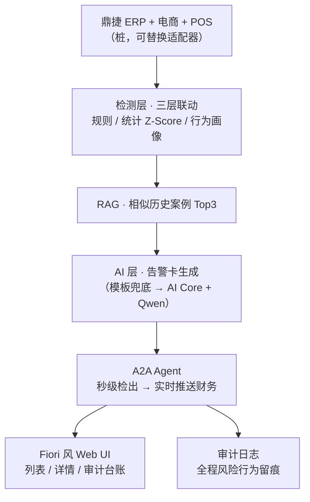

# 水星家纺 · 异常交易实时监测

> **TGD 2026 · GC Customer AI Use Case** — 场景 5「异常交易实时检测」
>
> AI 不只是「判定异常」，而是给出可执行的决策支持：**异常原因（三层联动）+ 相似历史案例 + 分级建议动作**，输出为结构化告警卡，展示在 SAP BTP Cockpit 风格界面上。

---

## 背景

水星家纺是国内头部家纺零售品牌，每日处理大量线上线下交易流水（电商、门店 POS、B2B 批发多渠道）。现有财务审计依赖人工抽查与月末对账，导致：

- **检测滞后** —— 异常往往 T+1 甚至月末才发现
- **覆盖率低** —— 人工抽查不足 5%
- **误报率高** —— 静态规则缺乏上下文理解
- **跨渠道盲区** —— 多系统孤岛（鼎捷 ERP / 电商 / POS）数据割裂

本项目构建一个 AI 驱动的实时监测能力，用**规则引擎 + 统计异常 + 行为画像**三层联动检测，并由 A2A Agent 秒级推送、全程审计留痕。

---

## 界面预览

**告警详情（中文）** —— 风险评分 gauge、三层联动原因、相似案例、分级建议、供应商画像趋势、处置时间线



**下钻查看依据** —— 点「查看命中的两笔交易」弹出证据表格，同发票号两笔标红（渐进式披露：表层说人话，深究见真相）



**一键中英文切换** —— 面向 CN + EU 客户，整页实时切换



---

## 架构



**三处可替换适配器**（接真实环境只需替换）：

| 当前实现 | 生产替换目标 |
|---------|-------------|
| `backend/data/alerts.json` 预制数据 | 鼎捷 ERP / BTP 集成层实时取数 |
| 结构化模板生成告警卡 | SAP AI Core + Qwen / Generative AI Hub |
| 静态历史案例 | HANA Cloud 向量引擎 RAG 检索 |

---

## 两个核心能力目标

- **可实时性（Target 1）** —— 采购人员提交重复付款时本人无意识，A2A Agent 秒级检出风险行为并实时推送财务，财务据此决策（拦截 / 升级 / 放行）
- **可溯源性（Target 2）** —— 从检出、推送到财务决定全程写入审计日志，定期审批时可按供应商 / 时段 / 经办人追溯完整风险行为，供审计参考（含「被放行」的异常）

---

## 运行

```bash
pip install -r requirements.txt
python -m uvicorn backend.main:app --port 8000
# 浏览器打开 http://127.0.0.1:8000/
```

静态高仿页（无需后端，直接双击打开）：`mockups/alert-detail.html`

---

## 演示脚本

1. 点「▶ 触发实时检测」—— 三层检测流水动画，发现 3 条异常
2. 点开 **供应商银行账户变更后首笔大额付款**（风险 91）—— 讲 BEC 欺诈 + 画像层间隔风险
3. 点开 **重复付款**（风险 82）—— 讲多系统孤岛跨渠道关联
4. 点开 **临界值聚集拆单**（风险 87）—— 讲统计层 Z-Score + 画像集中度
5. 强调每张卡的 ④ 建议动作（立即 / 24h内 / 可选）= 决策支持，而非「异常」标签

---

## 测试

```bash
python -m pytest tests/ -v
```

---

## 项目结构

```
backend/
  main.py              # FastAPI：告警 API + A2A 协议 + 静态托管
  data/alerts.json     # 3 张完整告警卡
frontend/              # Fiori 风单页应用（列表 / 详情）
mockups/
  alert-detail.html    # BTP Cockpit 风格告警详情页（含中英文切换、下钻弹窗）
tests/test_api.py      # API 契约冒烟测试
docs/                  # 设计规格 + 实现计划 + 方案合集
```

---

## 技术栈

Python · FastAPI · SQLite · 纯 HTML/JS/CSS（SAP Horizon 配色，无前端构建）· A2A 协议

> PoC 性质：告警卡数据为预制，检测算法与 LLM 调用通过适配层预留，可渐进式替换为真实引擎。
